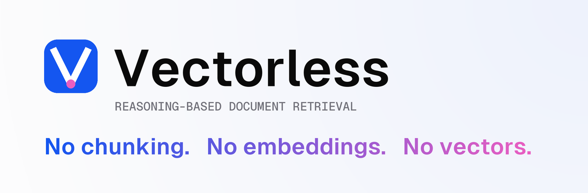
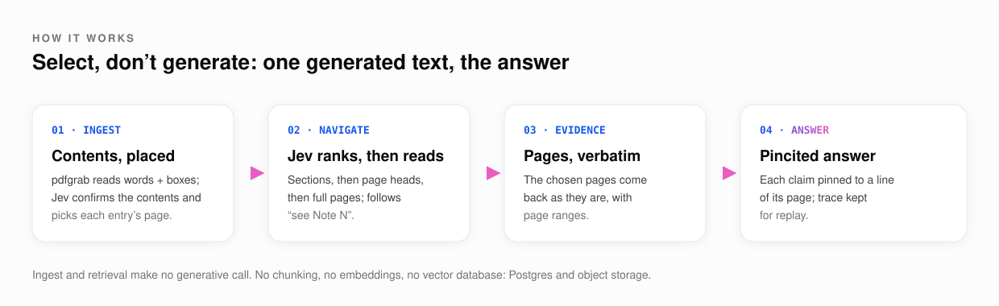
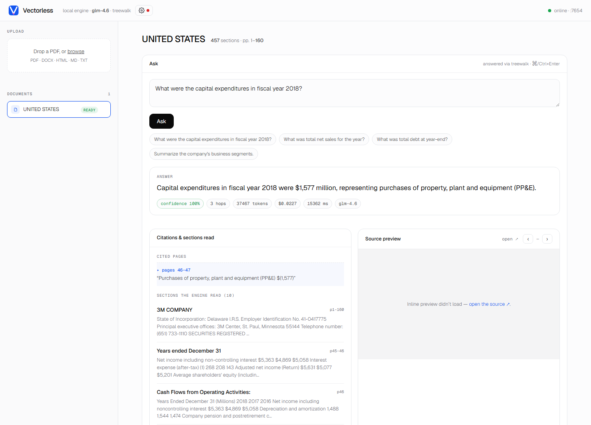

<p align="center">
  
</p>

<p align="center">
  <strong>A Go retrieval engine with no chunking, no embeddings and no vector database.</strong><br/>
  It finds a document's own contents, picks the pages that answer a question, returns those pages verbatim, and pins each claim in the answer to a line on its page.
</p>

<p align="center">
  <a href="LICENSE"></a>
  <a href="go.mod"></a>
  <a href="https://hub.docker.com/r/halleluyaholudele/vectorless"></a>
</p>

<p align="center">
  <a href="#status">Status</a> ·
  <a href="#how-it-works">How it works</a> ·
  <a href="#results">Results</a> ·
  <a href="#dependencies-you-should-know-about">Dependencies</a> ·
  <a href="#quick-start">Quick start</a> ·
  <a href="#http-api">API</a> ·
  <a href="#configuration">Config</a>
</p>

---

## Status

The hosted Vectorless service is closing (decided 2026-10-11). The code is open source under Apache 2.0 and is no longer actively developed. Issues and pull requests may not get a reply. For anything else, write to halleluyaholudele@gmail.com.

## How it works

The engine ships as a single binary and runs on Postgres plus object storage. Ingest builds a table of contents with page numbers. A query picks sections, then pages, and returns the pages as they are. The only generated text anywhere in the pipeline is the final answer.

<p align="center">
  
</p>

### Ingest (PDF)

1. **Layout.** [pdfgrab](https://github.com/hallelx2/pdfgrab), a pure-Go port of pdfplumber, reads every word and its rectangle on every page. The engine imports it under its earlier module path, `github.com/hallelx2/pdftable` v0.4.0.
2. **Contents found.** Code lists the candidate entries of the document's contents page. Jev, TypeSafe's System One model, confirms which ones are real.
3. **Contents placed.** For each entry, code searches the body for where that heading actually appears. Jev picks the page.
4. **Leaf splitting.** Any section longer than 20 pages is split at its own headings, so no leaf of the tree is huge. Jev decides which sub-headings to keep.
5. **Page images.** After the document is ready, `pdftoppm` renders each page at 144 dpi for the citation view.

Ingest makes no generative call ([2026-09-18 report](docs/evaluations/2026-09-18-toc-extraction-on-a-judge.md)). Markdown, HTML, DOCX and plain text are parsed into a heading tree instead. They have no pages, so they get no page images and no pincites.

### Query: judgewalk

The retrieval strategy is called `judgewalk` in configuration and `navigate` in API responses.

1. Jev ranks the tree's sections against the question.
2. It skims the head of each candidate page, then reads the best pages in full.
3. It follows cross-references such as "see Note 7" to the page they point at.
4. The chosen pages come back **verbatim**, with their page ranges.

Retrieval makes no generative call ([2026-09-18 report](docs/evaluations/2026-09-18-retrieval-navigation-on-a-judge.md)).

### Answer and pincites

A pincite is a citation to the exact page or line, the way a legal brief cites a page of a judgment.

1. A chat model of your choice writes the answer over the evidence pages, marking claims with `[n]`.
2. For each claim, code lists candidate quotes from that page's own sentences and table rows, and keeps a shortlist of 10.
3. Jev picks one quote per claim, in one batched call for the whole answer. It can also pick `none`.
4. If Jev's confidence is below 0.35, the citation falls back to page level.
5. The quote is located on the page exactly, or at 80% or more token overlap. Quotes under 4 tokens must match exactly.
6. The citation is drawn as one highlight rectangle per line, in page coordinates normalised to 0–1.

Citations come at line, page or section precision. There is no table-cell precision. Every quote is taken from the page's own text, so no generated text can reach a citation.

### Replay

Every answer is stored with a `trace_token`. `POST /v1/replay` with that token returns the stored response byte for byte. Replay is a record of what was answered. It does not re-run the query, and re-running would not necessarily give the same result (see [Results](#results)). The store is an in-memory LRU, 1,024 entries for 24 hours by default (`retrieval.replay`), so it does not survive a restart.

### The rule behind it

> If a decision can be written as a closed set of options, it goes to the judge.

Choosing a contents entry, a page, a section or a quote is a selection, not writing. Jev selects. A generative model writes only the answer. The reasoning is in [Judgement, not generation](docs/evaluations/2026-09-25-judgement-not-generation.md) (2026-09-25).

## Results

All figures are from FinanceBench 10-K filings unless stated. Each links to the report that measured it. The full list is in [docs/evaluations](docs/evaluations/README.md).

| Claim | Number | Date | Report |
|---|---|---|---|
| Building the contents tree on Jev instead of a generative model | 12–143 s and $0.0003–0.0015 per filing, against 103–840 s and $0.017–0.095; title recall 0.961 against the generative trees | 2026-09-18 | [toc-extraction-on-a-judge](docs/evaluations/2026-09-18-toc-extraction-on-a-judge.md) |
| Placing contents entries on their pages (11 filings) | Generative trees with no page resolver: 16/20 gold pages covered, median leaf 183 pages, $0.246. Same trees resolved on Jev: 20/20, median leaf 36 pages, $0.0046 | 2026-09-18 | [jev-page-resolver](docs/evaluations/2026-09-18-jev-page-resolver.md) |
| Navigation, first Jev run (40 questions) | 37/40 right section, 34/40 every gold page, $0.0029 per question | 2026-09-18 | [retrieval-navigation-on-a-judge](docs/evaluations/2026-09-18-retrieval-navigation-on-a-judge.md) |
| Navigation after leaf splitting | 40/40 right section, 36/40 every gold page, $0.0039 per question | 2026-09-19 | [leaf-granularity](docs/evaluations/2026-09-19-leaf-granularity.md) |
| Head-to-head at k=5: Vectorless, BGE-small embeddings, BM25 | hit@5 0.925 / 0.375 / 0.200; F1@5 0.498 / 0.170 / 0.096; answer in top-1 0.750 / 0.225 / 0.075 | 2026-09-21 run | [head-to-head-chunk-and-embed](docs/evaluations/2026-09-19-head-to-head-chunk-and-embed.md) |
| An embedding pre-filter does not help (negative result) | At k=50, BGE finds every gold page for 0.875 of questions, below judgewalk's 0.925 at k=5 | 2026-09-25 | [query-latency-and-the-embedding-prefilter](docs/evaluations/2026-09-25-query-latency-and-the-embedding-prefilter.md) |
| Query latency, navigator called directly | median 50.5 s became 1.9 s, still 36/40; $0.00402 became $0.00388 per question | 2026-09-28 | [latency-was-our-cpu](docs/evaluations/2026-09-28-latency-was-our-cpu.md) |
| Ingest latency per filing | median 66.1 s became 4.1 s, still 47/47 gold pages covered; $0.133 for 21 filings | 2026-09-28 | [latency-was-our-cpu](docs/evaluations/2026-09-28-latency-was-our-cpu.md) |
| Against PageIndex 0.2.22 on the 3M 2018 10-K (160 pages, 6 questions × 3 repeats) | retrieval median 1.70 s vs 7.05 s; full answer median 5.27 s vs 10.51 s; ingest 10.5–19.2 s vs 204–210 s; retrieved pages hold the answer 18/18 vs 17/18 | 2026-10-08 | [pageindex-latency](docs/evaluations/2026-10-08-pageindex-latency.md) |
| Run-to-run agreement across two repeats | The returned set matched exactly 0.38 of the time; Jaccard 0.83 | 2026-09-21 run | [head-to-head-chunk-and-embed](docs/evaluations/2026-09-19-head-to-head-chunk-and-embed.md) |

What these numbers do not show:

- **Retrieval is not answer accuracy.** hit@5 says the evidence was among the returned pages. It says nothing about whether the answer written from them was right. Do not set these figures against answer-accuracy figures such as PageIndex's published 98.7%. A small answer pilot (27/30 correct on 5 filings, graded with GLM-4.6 using the grading prompt from PageIndex's Mafin evaluation) is too small to compare with anything, and is not published as a report.
- **1.9 s and 4.1 s are benchmark-tool figures.** navbench calls the navigator directly, without the HTTP layer, database reads or the answer. The production API answered in about 3.5–6 s.
- **The PageIndex comparison is one filing on one machine.** When both systems use the same generative model for navigation, the answer gap narrows to 7.6 s against 10.5 s at the median and PageIndex wins 2 of 6 questions. The report says what it does not claim.
- **Jev is not deterministic.** See the run-to-run row above. Replay returns a stored answer; it does not make the engine deterministic.
- **Multi-hop questions are unmeasured.**

Pincite figures are from one filing, the 3M 2022 10-K (252 pages): the page layout was built in 3.0 s, the pincite step takes 0.4–0.6 s inside `/v1/answer`, and every claim checked by eye landed at line precision. That last one is a small visual check, not a benchmark.

To reproduce the FinanceBench runs, see `cmd/navbench`, `cmd/tocdump` and the harness in [vectorless-bench](https://github.com/hallelx2/vectorless-bench). Each report lists its harness, corpus and commands.

## Dependencies you should know about

- **Jev is a hosted API.** It is TypeSafe's System One model (`jev-latest`, endpoint `api.typesafe.ai/v1/systemone`). System One models make fast, structured decisions and write no prose. One call carries a shared state and N typed questions: yes/no with a probability, a choice among options with the distribution, or a position on an ordered scale. It costs $0.042 per million input tokens and output is free. Its size is not published. With a key set, document text is sent to TypeSafe, so "nothing leaves your network" is not true.
- **Set the key** with `TYPESAFE_API_KEY` (or `VLE_TYPESAFE_API_KEY` / `VLS_TYPESAFE_API_KEY`). `TYPESAFE_BASE_URL` and `TYPESAFE_MODEL` override the endpoint and model.
- **Without a key** the engine still runs, but not the pipeline measured above:
  - Ingest runs the contents-page decisions on your generative model, one call per page. It is minutes slower on long filings, and leaf splitting is off.
  - `judgewalk` falls back to `treewalk`, where your chat model walks the pages in up to eight generative hops.
  - Pincites choose quotes by word overlap instead of Jev.
- **When Jev refuses** (no credit, a rejected key, an outage), the server binary serves the query with `treewalk` instead and logs `retrieval: primary model unavailable, served by fallback`. This was added after the Judge provider ran out of credit on 2026-10-08 and every production query failed for as long as it lasted.
- **A generative model** writes answers: Anthropic, OpenAI, Gemini, or an Anthropic-compatible gateway such as GLM on z.ai. Callers can also send their own key per request.
- **poppler's `pdftoppm`** renders page images. `Dockerfile.server` installs it.

## Quick start

The engine has two entry points:

| Binary | What it is | Use it for |
|---|---|---|
| `cmd/server` (`Dockerfile.server`) | The multi-tenant HTTP server production ran. It has pincites, page images, live ingest progress and the strategy fallback. | Running the pipeline described above. |
| `cmd/engine` (`Dockerfile`, `Dockerfile.allinone`) | The standalone engine with `--local` zero-config mode and the `/v1/replay` route. | Trying the engine on a laptop. |

### All-in-one container

One container with the engine, a bundled Postgres and a web UI. The image defaults to fast `minimal` ingest and GLM through z.ai, so it does not run the Jev pipeline unless you turn it on:

```bash
docker run -p 8080:8080 -p 7654:7654 \
  -e VLE_LLM_ANTHROPIC_API_KEY=<your key> \
  -e TYPESAFE_API_KEY=<your TypeSafe key> \
  -e VLE_INGEST_MODE=toc \
  -e VLE_RETRIEVAL_STRATEGY=judgewalk \
  halleluyaholudele/vectorless
# UI  → http://localhost:8080
# API → http://localhost:7654
```

<p align="center">
  
</p>

### From source (Go 1.25+, Postgres)

```bash
git clone https://github.com/hallelx2/vectorless-engine.git && cd vectorless-engine
docker compose up -d postgres
export VLE_LLM_ANTHROPIC_API_KEY=<your key>
export TYPESAFE_API_KEY=<your TypeSafe key>
export VLE_INGEST_MODE=toc VLE_RETRIEVAL_STRATEGY=judgewalk
go run ./cmd/engine --local      # zero-config local mode on :7654
```

A full self-host stack (dashboard, control plane, engine and Postgres from one `docker compose up`) is being prepared in the `vectorless` repository (HAL-2663, in progress on 2026-10-11).

## HTTP API

Routes are versioned under `/v1`. This is the server binary's surface.

| Method | Path | Purpose |
|--------|------|---------|
| `GET`  | `/v1/health` · `/v1/version` | Liveness and build |
| `POST` | `/v1/documents` | Ingest a document (multipart or URL; async, 202) |
| `GET`  | `/v1/documents` · `/v1/documents/{id}` | List, or get status and ingest progress |
| `DELETE` | `/v1/documents/{id}` | Delete a document and its stored files |
| `GET`  | `/v1/documents/{id}/tree` · `/structure` | Section tree; structure with page spans |
| `GET`  | `/v1/documents/{id}/llms.txt` · `/text` · `/source` | Contents as llms.txt; plain text; original bytes |
| `GET`  | `/v1/documents/{id}/pages` · `/pages/{n}/image` | Page sizes for pincites; one page image |
| `GET`  | `/v1/sections/{id}` | One section with its content |
| `POST` | `/v1/query` · `/v1/query/stream` | Retrieve evidence (streamed: one event per navigation stage) |
| `POST` | `/v1/query/multi` · `/v1/query/multi/stream` | Retrieve across several documents |
| `POST` | `/v1/answer` | Retrieve, answer and pincite in one round trip |
| `POST` | `/v1/answer/treewalk` | Answer with the generative page walk |
| `POST` | `/v1/answer/store` | One answer across a store of documents, with per-document citations |

`POST /v1/replay` is served by `cmd/engine`. On this commit `cmd/server` records replay traces but does not register the route.

Per-request model keys (BYOK): `X-LLM-Api-Key`, with optional `X-LLM-Provider`, `X-LLM-Base-Url` and `X-LLM-Model`. Nothing about the key is logged or stored.

## SDKs and MCP

Clients for TypeScript (npm `vectorless`), Python (PyPI `vectorless-sdk`) and Go live in [`vectorless-sdk`](https://github.com/hallelx2/vectorless-sdk). [`vectorless-mcp`](https://github.com/hallelx2/vectorless-mcp) exposes seven tools to agents: list, ingest, get and delete document, get_tree, get_section, and query.

## Architecture

A single Go binary with pluggable boundaries:

| Boundary | Implementations |
|----------|-----------------|
| **Storage** | Local filesystem · S3-compatible (R2, MinIO, B2, Spaces) · Google Cloud Storage |
| **Queue**   | River (Postgres) · Asynq (Redis) · QStash (serverless) |
| **Generative model** | Anthropic · OpenAI · Gemini, and Anthropic-compatible gateways (GLM on z.ai), through [llmgate](https://github.com/hallelx2/llmgate) |
| **Judge** | TypeSafe Jev through llmgate's Judge interface |
| **Retrieval** | `judgewalk` (the pipeline above) · `treewalk` (generative page walk) · `auto` (the config default) · `single-pass` · `chunked-tree` · `agentic` |
| **Ingest mode** | `toc` (the pipeline above) · `minimal` (parse and store, seconds) · `full` (adds the older generative per-section summaries and enrichment) |

`single-pass`, `chunked-tree`, `agentic` and the `full` ingest mode are the original design, in which a chat model summarised every section at ingest and navigated those summaries at query time. They still build and run, but the evaluations above did not use them. Design docs in [docs/](docs/README.md) predate the current pipeline in places and say so at the top.

## Configuration

Config layers, in increasing priority: `--config <yaml>`, then `VLE_*` (engine) or `VLS_*` (server) environment variables, then CLI flags. [`config.example.yaml`](config.example.yaml) is the full reference. The settings production ran with:

```yaml
engine:
  llm:
    driver: anthropic          # the answer model; key from VLE_LLM_ANTHROPIC_API_KEY
    judge:
      typesafe: {}             # key from TYPESAFE_API_KEY
  retrieval:
    strategy: judgewalk
    replay: { enabled: true }
  ingest:
    mode: toc
```

> **Anthropic-compatible gateways (GLM on z.ai):** `base_url` must include `/v1`. The client posts to `${base_url}/messages`.

> **Windows and local storage:** Windows Defender's real-time scan can briefly hide a freshly written file, which under heavy concurrent ingest shows up as transient `object not found` errors. The local backend retries through this, but for bulk loads add a Defender exclusion for your storage root: `Add-MpPreference -ExclusionPath "C:\path\to\data\documents"`.

## Related

- [`pdfgrab`](https://github.com/hallelx2/pdfgrab): the PDF layout parser (MIT)
- [`llmgate`](https://github.com/hallelx2/llmgate): provider clients, router, retries, budgets, and the Judge interface (Apache 2.0)
- [`vectorless-sdk`](https://github.com/hallelx2/vectorless-sdk): TypeScript, Python and Go clients
- [`vectorless-bench`](https://github.com/hallelx2/vectorless-bench): a harness that reports quality, cost, latency and determinism together

## License

[Apache 2.0](LICENSE).
